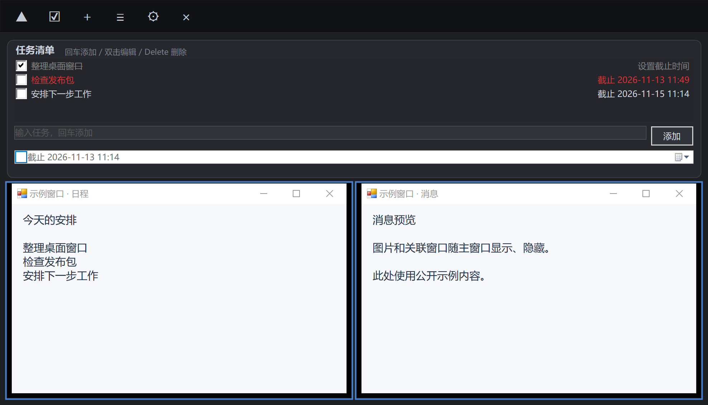
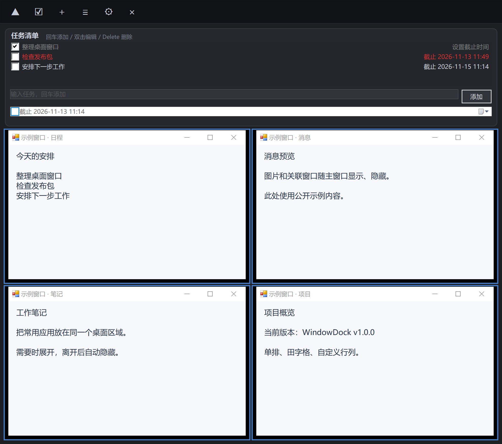
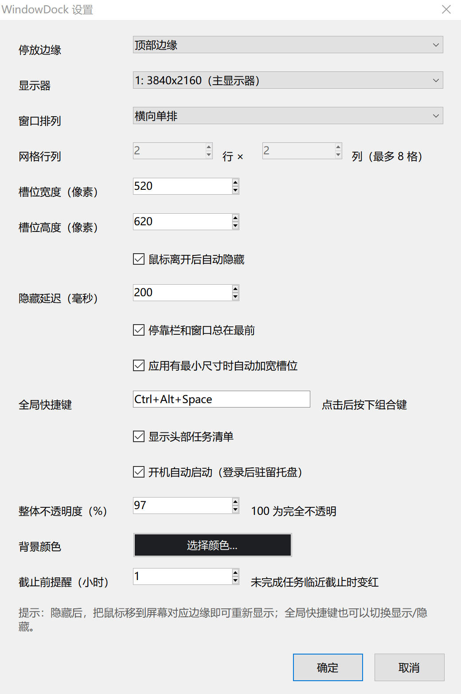

# WindowDock

Windows 桌面窗口停靠栏，可将多个应用窗口排列在屏幕边缘，并提供带独立截止时间的任务清单。

## 下载

[下载 v1.0.0（Windows x64 ZIP）](https://github.com/qingniaoheyu/WindowDock/releases/download/v1.0.0/WindowDock-v1.0.0-win-x64.zip)，解压后双击 `WindowDock.exe` 即可运行，无需安装。适用于 Windows 10/11 x64，需要 .NET Framework 4.x 运行环境。

[Release 页面](https://github.com/qingniaoheyu/WindowDock/releases/tag/v1.0.0)同时提供独立 EXE 和 `SHA256SUMS.txt` 校验文件。

## 界面截图

主界面展示当前 v1.0.0 的单排和田字格布局，使用示例窗口与任务内容；设置截图来自当前设置页面。

### 单排与任务清单



### 田字格布局



### 设置



## 功能

- 最多管理 8 个窗口，支持单排、田字格（2×2）和自定义行列。
- 支持左、右、上、下四个停靠边缘、显示器选择、窗口置顶和自动隐藏。
- 关联的图片预览或对话框随主窗口显示、隐藏，并保持在主窗口上方。
- 可选择背景颜色和整体透明度；Qt 窗口保留原生透明度，兼容其界面切换和逐像素绘制。
- 可设置当前用户登录 Windows 后自动启动，并驻留系统托盘。
- 设置、槽位管理和截止时间等对话框保持在绑定窗口上方，打开期间暂停后台窗口层级调整。
- 每个任务可独立设置或清除 deadline。完成后显示灰色删除线，临近截止时间或已逾期的未完成任务显示红色。
- 外部窗口的显示、隐藏和位置调整使用异步请求，透明度修改在后台执行，避免外部应用无响应时拖住停靠栏。
- 输入任务时暂停后台窗口调整，中文输入法选词时的回车、Esc 交给输入法处理。

网格尺寸受屏幕空间和应用窗口的原生最小尺寸限制。空间不足时会提示；窗口尺寸或显示器发生变化时，必要时退回单排。

## 构建与运行

需要 Windows 10/11，以及 .NET Framework 4.x 的 C# 编译器。构建脚本使用系统自带的路径：

```text
C:\Windows\Microsoft.NET\Framework64\v4.0.30319\csc.exe
```

在 PowerShell 中执行：

```powershell
powershell -NoProfile -ExecutionPolicy Bypass -File .\build.ps1
.\dist\WindowDock.exe
```

生成的程序位于 `dist/WindowDock.exe`。默认快捷键为 **Ctrl + Alt + Space**，可在设置中修改。通过停靠栏或系统托盘的菜单设置窗口、布局、外观和开机启动。

任务列表右侧的日期或“设置截止时间”可点击编辑，选中任务后也可按 **F2**。点击复选框或按空格切换完成状态，双击任务文字编辑，按 Delete 删除选中的任务。

程序运行后，可用以下命令控制现有实例：

```powershell
.\dist\WindowDock.exe --show
.\dist\WindowDock.exe --hide
.\dist\WindowDock.exe --settings
.\dist\WindowDock.exe --slots
.\dist\WindowDock.exe --exit
```

`--startup` 用于登录后隐藏启动；再次调用不会切换现有实例的显示状态。

## 配置与日志

配置保存在程序所在目录的 `WindowDock.ini`；该目录不可写时使用 `%LOCALAPPDATA%\WindowDock`。任务、窗口绑定和外观设置会持久化。

调试日志为 `WindowDock_dbg.log`，卡顿超过两秒时记录当前操作，相关记录包含 `[ysw]`。异常日志为 `WindowDock_error.log`。

个人配置、日志、原始个人截图和本地排障文件不会提交到仓库。公开展示截图保存在 `docs/screenshots`，构建产物通过 GitHub Release 提供。

## 回归验证

先构建主程序，再在 Windows 的交互式桌面中按顺序执行：

```powershell
powershell -NoProfile -ExecutionPolicy Bypass -File .\_test\feature_validation\run.ps1
powershell -NoProfile -ExecutionPolicy Bypass -File .\_test\layout_validation\run.ps1
powershell -NoProfile -ExecutionPolicy Bypass -File .\_test\hang_validation\run.ps1
```

当前验证共 131 项：65 项功能、对话框层级与 Qt 绘制检查、28 项布局和独立 deadline 检查、38 项输入法、无响应窗口与恢复检查。

测试会创建独立的测试窗口，各自的配置和产物保存在测试目录中。布局验证使用功能验证生成的测试窗口程序，因此需要按上述顺序运行。测试需要交互式桌面；请避免同时操作测试窗口。
